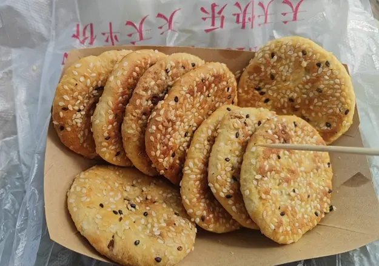
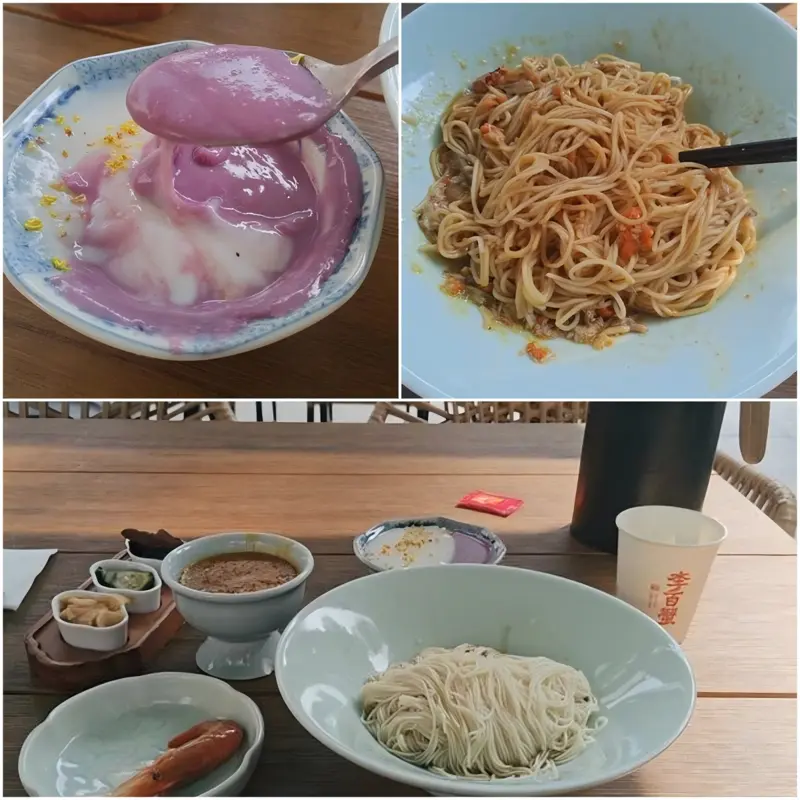

到西湖时，已经是上午十点半了。眼前是一大片湖水，远处的山笼在薄雾里。湖面上有许多载着游客的小船，从近处一直散布到远处。岸边也有不少游人，有的沿湖散步，有的拿着手机拍照。

我从西湖东北边出发，沿着湖岸逆时针走。没走多远，便到了《白蛇传》中白素贞与许仙相遇的断桥。桥虽名“断”，却好端端地横在湖上，周末的游客正从桥上来来往往。据说，“断桥”一名由“段家桥”演变而来，不过也有与“断桥残雪”有关的说法。虽然不是节假日，但毕竟是周末，桥上的游客依然很多。人们三三两两地往前走，不时有人停下来拍照。好在桥面不算狭窄，虽然人多，倒也不至于走不动。

过了断桥，便踏上了白居易笔下的白沙堤。“最爱湖东行不足，绿杨阴里白沙堤”，这是白居易在《钱塘湖春行》中写下的诗句。诗中的白沙堤便是如今的白堤，虽以白居易的姓氏命名，却并非他亲手修筑。沿着白堤往前走，左边是一大片开阔的湖水，水面离道路很近，中间也没有护栏。

走完白堤，便到了苏轼笔下“道人有道山不孤”的孤山。西湖素有“断桥不断，孤山不孤”的说法。所谓“孤山不孤”，说的是山上曾有高僧居住，因而不显孤独。

孤山并不高，山间却有不少岔路。每到一个岔路口，我都要考虑接下来往哪个方向走。我向来不太喜欢这种四通八达的游览路线，若是只有一条路，沿着它一直走就好。沿途大多是树木，走了几段路，也没遇到什么景点。我正觉得这山上没多少东西可看，便听见一位老大爷自言自语地嘀咕：“啥都没有”。当时听着倒觉得有些好笑，等自己沿着路走出了孤山，再回想一路上的树木和岔路，竟也没觉得逛到了多少东西。老大爷那句话，倒是说出了我的感受。

离开孤山，继续沿着湖边往前，便到了曲院风荷。这里与白堤很不一样。湖面没有那么开阔，水边有桥，也有屋舍。刚进园子，便看到几座临水的房屋，后面是一座石桥。岸边长着树木，枝叶垂向水面，房屋与树木的影子映在湖里。这样的景色，倒像是乡间的一处水岸。

.webp)

沿着园中的道路继续往前走，才知道“曲院”原来与酿酒有关。南宋时，这里曾有酿酒的作坊，附近又种着荷花，后来便有了“曲院风荷”这个名字。

.webp)

快到出口时，我走上一座桥。桥边长着一片荷叶，湖水从荷叶间向远处铺开。对岸的几座矮楼掩映在树木之间，再往后是连绵的山。

.webp)

离开曲院风荷，我走上了苏轼疏浚西湖时主持修筑的苏堤。与前面因白居易而得名的白堤不同，这条长堤确实出自苏轼治湖的工程，后人为了纪念他，便以他的姓氏命名。

苏堤很长，两边是湖水，路旁种着树。我沿着堤岸一直往南走，周围的景色变化不大。途中买了一份咸香口的东坡酥饼，边走边吃。味道还行，只是吃多了便不太想吃了。

继续往南走，远远望见了雷峰塔。上午走过的断桥是《白蛇传》中白素贞与许仙相遇的地方，而眼前的雷峰塔，则是传说中白素贞被法海镇压的地方。塔立在山上，中间隔着一片树木，近处的湖面上有许多游船。

越接近苏堤南端，路上的人越多。原本还能从容地往前走，后来周围渐渐都是游客。我随着人流继续向南，终于走出了苏堤。

走出苏堤，已经到了吃午饭的时候。我没有提前选好餐厅，只想着既然来了杭州，不妨吃点好的。于是在西湖附近找到了李百蟹，准备尝尝蟹黄面。店里正在排队，好在等候时间不长，十多分钟便轮到了我。小桌都坐满了，服务员便把我领到一张六人桌前。我一个人坐下，点了一份蟹黄面套餐。江南素有吃蟹的传统，苏州人尤其讲究蟹黄、蟹膏入面。这次到了杭州，我也正好尝个新鲜。而直到我吃完，另外五张椅子也始终空着。

结完账走出店门，已经是下午一点半了。沿着路继续往前，不久又看到了雷峰塔。上午在苏堤上，还隔着湖水远远望见它，如今已经走到了附近。

至此，西湖之行便告一段落。

