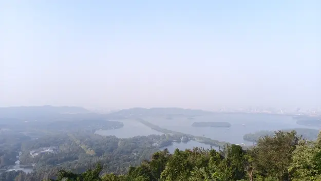
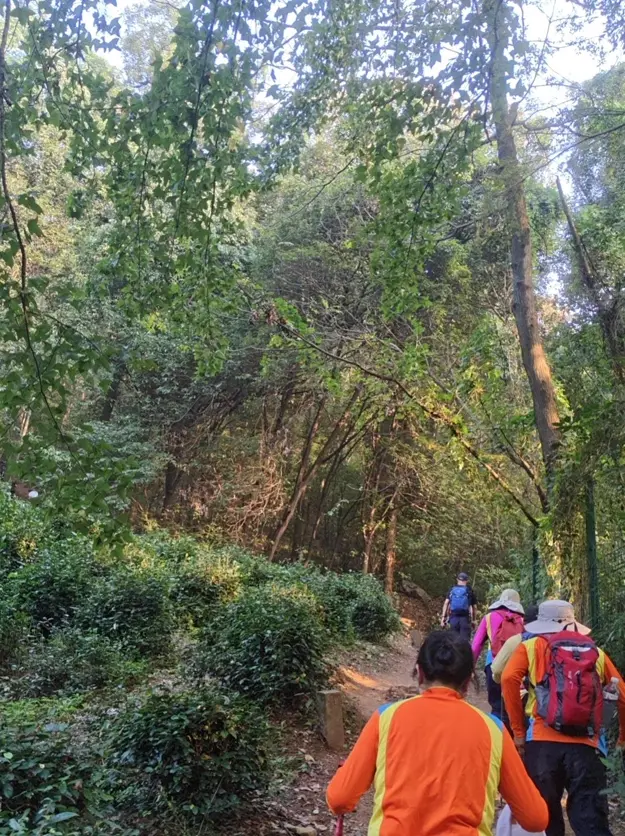
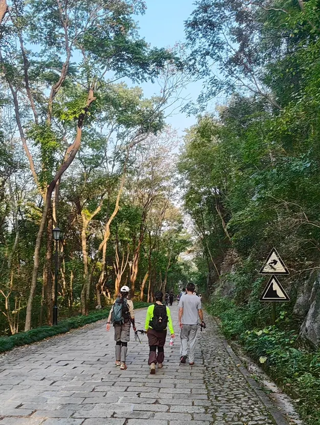
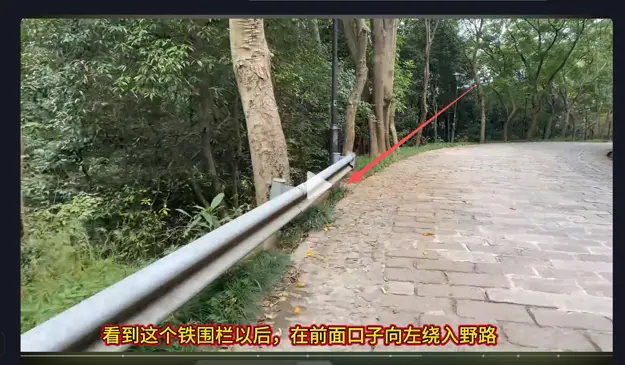
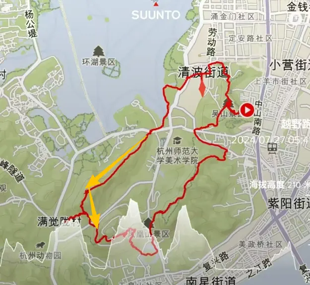

吃过午饭，我沿着西湖边的道路继续往前走。经过雷峰塔附近时，看到路边有一条上山的台阶。不少游客正从台阶上下来，也有少数人往上走。我原本就有下午登山的打算，既然这里有路，便跟着上去了。

一路看着地图，经过南屏山、莲子峰，继续往九耀山走。山上的游客不少，只是方向似乎和我不太一样。迎面下山的人一拨接着一拨，我却一直往上走。好在体力还不错，台阶虽然有些陡，走起来倒不怎么费劲。

沿着台阶登上九耀山，便来到了九耀阁。阁楼设有观景处，旁边还有亭子和小卖部。许多游客在这里休息，有人坐着，有人拍照。我也来到观景处，向外望去，西湖就在眼前。近处是大片树林，往远处看，湖面、小岛、苏堤，还有杭州城里的楼房，都能收入眼底。上午还在苏堤上走了好一阵，现在从山上看，那条长堤就横在湖水之间。

不得不说，西湖还是从山上看更漂亮。爬了一路山，身体活动开了，眼前又是这样的景色，整个人都舒畅了不少。

拍完照片，我开始考虑从哪里下山。眼前只有两个选择，要么沿着台阶原路返回，要么从另一边的土路下山。我不太想走回头路，便看了看地图。上面确实标着这条土路，旁边也有人往那边走，于是我跟了过去。

刚走上去，便发现这路和先前的台阶很不一样。脚下是踩实的黄土，夹杂着大大小小的石头。有些天然的大石头正好能当台阶，只是高低不齐。下山的时候，得低头看准落脚的位置，踩稳了再走下一步。一两处特别陡的地方，甚至还得伸手扶着石头，手脚并用地过去。

比坡陡更麻烦的是路窄。左边是十几度的缓坡，右边却是一道七八十度的陡坡，看着几乎像悬崖。有的地方勉强能容两个人同时通过，但都走得不方便；再窄一点，便只能走一个人。

偏偏迎面上山的人还不少。遇到只能一人通行的地方，就得轮流走。我们这边停下来，让对面的人先过；等他们过去，再继续下山。有时候刚走几步，前面的人又停下来了，只好跟着等。

走着走着，土路旁分出了一条相对平坦的小路。我在岔路口琢磨了好一阵，不知道往哪边走。正好有一支十人左右的徒步队伍经过，大家穿着统一的衣服，背着登山包，不少人还拿着登山杖，队伍里也有上了年纪的阿姨。看着倒像是经常爬山的人。他们往那条小路走，我便决定跟在后面，看看这条路到底通往哪里。

小路逐渐向上，脚下仍是黄土和石头。我一直跟在队伍后面，后面又陆续有人跟上来。这下倒好，前后都是人，我终于不再逆着人流走了。走了一阵，前面的人爬上一处土坡。我跟着上去，没想到眼前竟是一条盘山公路。公路铺着凹凸不平的石板，虽然算不上平整，但总比刚才的黄土路宽敞得多。脚下终于不用再小心翼翼地找地方踩，顿时轻松了不少。

那支徒步队伍倒是很自然，爬上公路便继续往前走，连方向都不用辨认，仿佛早就知道这条路通向哪里。我却忍不住回头看了看。刚才爬上来的地方，就是公路边的一处土坡。后面还有人陆续从那里爬上来，也有人从公路边下去，沿着土路进山。

我站在公路上，看着那些来来往往的人，还是觉得不可思议。这样一条又窄又陡的黄土路，竟然有这么多人走。更没想到的是，跟着人群走了这么久，最后竟从一条盘山公路的路边冒了出来。

后来上网查了才知道，原来我走的这段山路是“小猪徒步线”的一部分，只不过方向恰好与常见的徒步路线相反。难怪一路上总是迎面遇到上山的人，而下山时还得不断给他们让路。绕了这么一圈，先前那些不明白的事情，倒都有了解释。

