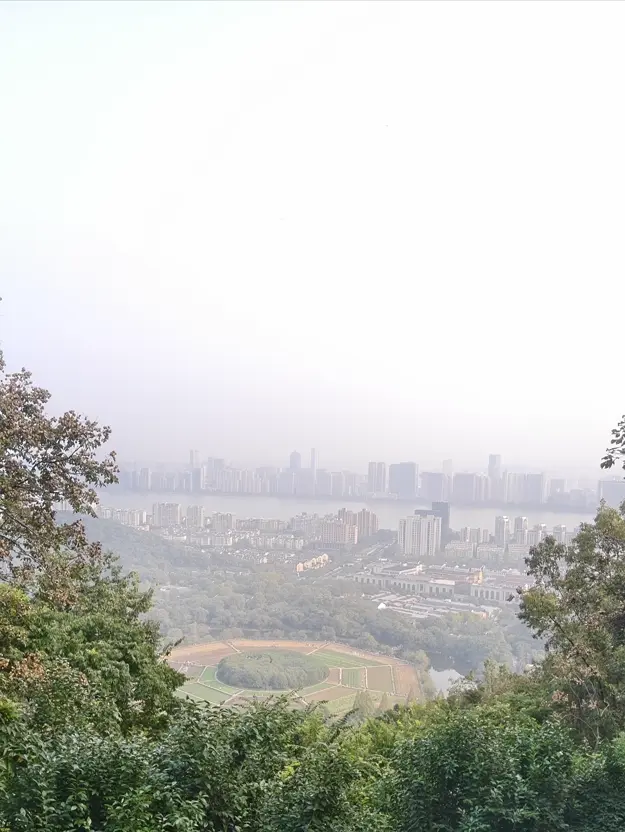
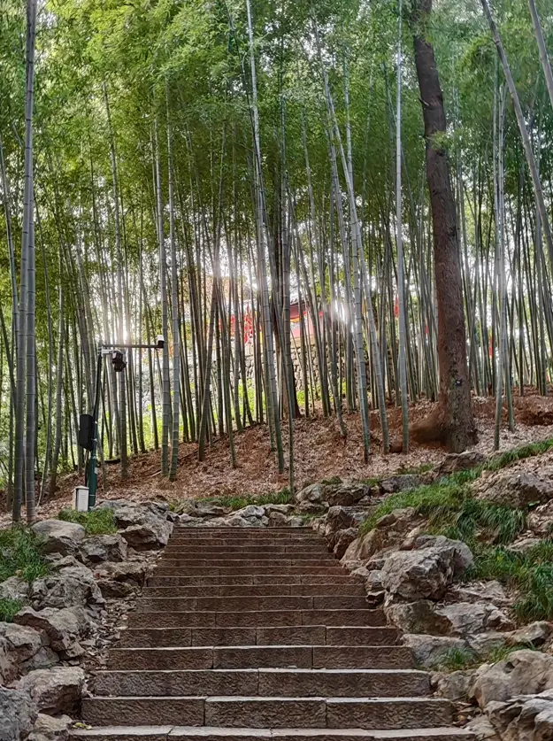
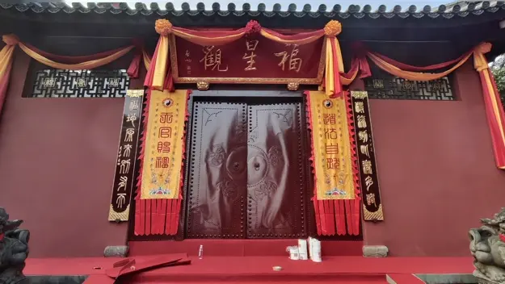

从野路走上盘山公路后，我沿着路继续前行。没过多久，便看到通往玉皇山的台阶。比起刚才的黄土山路，这里的路好走得多，至少不必再担心脚下打滑。

沿台阶往上，途中经过老玉皇宫。我在外面看了一眼，没有进去，继续往前走。再往上遇到一个岔路口，一边通往紫来洞，一边通往福星观。我先朝福星观的方向走了一段，没发现什么特别的，便折返回来。

这时迎面遇见一位阿姨。她问我是不是从福星观下来的，又向我打听怎么走。我也是第一次来，对山上的道路并不熟悉，只能把自己知道的告诉她。见大多数游客都往紫来洞方向走，我便也跟了过去，阿姨随后也往那边去了。

紫来洞附近有一处观景的地方，可以俯瞰山下的八卦田。近处的树木挡住了一部分视线，往树梢外看，田地正好露在山脚下。中间是一片近圆形的树林，外围的田块一块接着一块，绕着中心排开。有的地块是绿色的，有的露着黄褐色的土，浅色的田埂把它们隔开。从这里看下去，田块不大，整个轮廓倒很清楚，颇像一幅八卦图。

离开紫来洞，我继续沿台阶前往福星观。途中经过一片竹林，石阶从林子中间往上延伸。竹子长得很密，细长的竹竿一根根立在坡上，中间夹着几棵树干较粗的树。往上看，竹竿的缝隙间露出一点红色的墙和屋檐，那便是福星观。

走到福星观，才发现大门紧闭，门楣上挂着“福星观”的匾，两旁垂着黄底红边的长幡，檐下的红黄绸布还挂着。旁边贴着维修公告，我站在门前看了看，只能到这里了。

既然进不去，我便到附近转了转。停车场旁的树木之间有一处空隙，可以越过山林望见远处。近处的树冠挤在一起，深绿中夹着一些黄叶。稍远处是一道低矮的山脊，颜色比眼前的树林淡了许多。我在那里拍了几张照片，随后沿路下山。

.webp)

回到盘山公路，竟又遇见刚才问路的阿姨。她正在路边休息，认出了我，便问：“你是从景区下来的吗？” 这回我确实刚从福星观下来，便告诉她上面正在维修，大门关着，没能进去。说了几句，我先沿着公路继续往下走。

走到一处下坡，我跟着前面的游客转入台阶路。正走着，忽然听见后面有人叫我。回头一看，还是那位阿姨。她问我准备去哪里，是不是要下山出去。我说是，她便与我一道往山下走。

一路上，我们边走边聊。她问我从哪里来、在哪里读过书、现在做什么工作，我也说起今天在西湖和山上的经历。她是杭州本地人，已经退休，平时每个星期都会来爬山。虽然上了年纪，腿脚却十分利索，走起台阶来一点也不慢。

从最初在岔路口问路，到后来在盘山公路旁碰面，再到现在一起下山，短短一段山路，我们竟遇见了三次。前两回只是说了几句话，到了第三回，反而成了同行的人。

下到山脚，已经接近下午五点。附近车多、人也多。阿姨想找一趟能够直接回去的公交车，却一时没找到合适的。她让我不用管她，先忙自己的事，我便与她道别，按照导航继续往钱塘江走。

出山时太阳已经快落下了。走到半路，天色渐渐暗下来，等我真正走到江边，已经入夜。江岸修着步行道，沿路有护栏和路灯，不能直接走到水边。附近散步的人不多，临江这一侧没有什么遮挡，站定后，眼前便是一大片暗下来的水面。对岸的灯光映在水面上，拖出几道长短不一的亮痕。江面并不平整，一层层细小的水纹挨着过来，把那些倒影分成许多短短的光点。

.webp)

江边很暗，沿路的几盏路灯亮着黄色的光。前面还有一处白光，比路灯亮得多。沿江走近了，才发现那白色亮光竟是钓鱼人的手电筒。

.webp)

走了大半天的路，又爬了两座山，这时脚已经开始疼了。沿江再走了一段，疲惫的感觉越来越明显，连看风景的兴致也少了许多。

路边正好有共享单车，我便骑上一辆，直奔地铁站。随后乘地铁到了火车站，晚上七点半左右坐上离开杭州的火车。
